# How state changes flow through batches

> **Branch:** `async-another-try-pt-1` ([#18880](https://github.com/sveltejs/svelte/pull/18880)), written against `b759278c62`.
>
> This describes the async reactivity model _without_ fork reconciliation. `main` uses an older model (later batches are "rebased" when an earlier one commits), and pt-2 adds fork handling on top of this one. If you change the behaviour described here, please update this document in the same PR.

Everything here applies to async mode (`experimental.async`). Without it, `Batch.apply()` returns early and most of the multi-batch machinery is bypassed.

Each scenario in [section 10](#10-scenarios) corresponds to a test in `packages/svelte/tests/runtime-runes/samples`, and the step-by-step sequences were checked by instrumenting the runtime and running those tests (see [section 12](#12-tracing-the-runtime)).

- [1. Vocabulary](#1-vocabulary)
- [2. The guiding principle](#2-the-guiding-principle)
- [3. What a batch keeps track of](#3-what-a-batch-keeps-track-of)
- [4. Lifecycle of a batch](#4-lifecycle-of-a-batch)
- [5. One batch, no async work](#5-one-batch-no-async-work)
- [6. One batch with async work](#6-one-batch-with-async-work)
- [7. Several batches at once: time travelling](#7-several-batches-at-once-time-travelling)
- [8. How batches become dependent on each other](#8-how-batches-become-dependent-on-each-other)
- [9. Merging and committing](#9-merging-and-committing)
- [10. Scenarios](#10-scenarios)
- [11. Known rough edges](#11-known-rough-edges)
- [12. Tracing the runtime](#12-tracing-the-runtime)

## 1. Vocabulary

**Signals.** A _source_ (`$state`) holds a value `v` and a _write version_ `wv`, which is taken from a global counter that increases on every write. A _derived_ (`$derived`) also has a `v` and `wv`, and is recomputed lazily when it is read while dirty. An _async derived_ (an `await` in the template, or `$derived(await ...)`) is an _async effect_ that writes its result into a plain source when the promise resolves (`async_derived` in `deriveds.js`).

**Status flags.** `CLEAN`, `MAYBE_DIRTY` and `DIRTY` live on the reaction object itself, so **all batches share them**. A lot of what follows exists to stop one batch's status changes from corrupting another batch's view.

**Effects**, grouped by what a batch does with them while it walks the effect tree (`Batch.#traverse`):

| Kind                    | Examples                                                                                | When it runs                                                                  |
| ----------------------- | --------------------------------------------------------------------------------------- | ----------------------------------------------------------------------------- |
| Branch / root           | the contents of an `{#if}` branch or `{#each}` item, the root created by `mount(...)`   | Never runs itself. Traversal descends into it unless it is `CLEAN` or skipped |
| Block effect            | `{#if}`, `{#each}`, `{#key}`, `{#await}`, `<svelte:boundary>`                           | **During traversal**, if dirty                                                |
| Async effect            | the effect behind every `await` expression                                              | **During traversal**, if dirty                                                |
| Render / managed effect | template expressions (`template_effect`), `$effect.pre`, attachments, attribute spreads | Collected during traversal, run at **commit**                                 |
| User effect             | `$effect`                                                                               | Collected during traversal, run at **commit** (after render effects)          |
| Eager effect            | `$inspect`, the machinery behind `$state.eager`                                         | Synchronously, straight after the write                                       |

There is one exception: an effect that is **created** during traversal (for example because an `{#if}` became truthy and created a new branch) runs immediately on creation (`create_effect` calls `update_effect`), unless it is an `$effect`, which is collected and runs at commit.

The split between "runs during traversal" and "runs at commit" matters, because **only work done during traversal can make one batch depend on another** ([section 8](#8-how-batches-become-dependent-on-each-other)).

**Batch.** A batch is the unit of change (`Batch` in `batch.js`). The first write made while no batch is active creates one (`Batch.ensure()`), and the batch flushes in a microtask, so every write in the same synchronous turn (e.g. one event handler) goes into the same batch. Async work started while processing a batch belongs to that batch, and when it resolves its result is written back into the same batch, or into the batch it has since been merged into. Writes made while a batch's effects run at commit go into a new batch.

Batches form a linked list (`first_batch` … `last_batch`) ordered by creation, and `id` increases monotonically. "Earlier" and "later" always refer to this order.

**Pending vs committed.** A batch _commits_ once it has no _blocking_ async work left: its DOM changes are applied and its render and user effects run. Until then it is _pending_, and other batches can be created, processed and even committed in the meantime.

**Real world vs a batch's view.** Every signal has exactly one real value, `signal.v`. While several batches are pending, each one must still see a consistent world. Before doing any work inside a batch, the runtime fills `batch_values` and `wv_values` (`Batch.apply()`), and `get()` returns the value from there instead of `signal.v`. The code calls this _time travelling_.

**Dependent batches.** Batch B _depends on_ an earlier batch A if B observed or overwrote changes that A has not committed yet. B can then never commit before A. If B finishes first, it is _merged_ into A and they commit together. In the code this is `B.dependent.has(A)`. Note that the JSDoc on `dependent` currently says the reverse ("batches that depend on this batch"). The usages are what's described here.

## 2. The guiding principle

> Changes are applied in the order they happened. A batch may only commit ahead of an earlier pending batch if nothing it computed depended on that batch.

The PR description gives the canonical example: `{await delay(a + '|' + b)}`. You change `a`, then `b`, and the promise for the second change resolves first. In a synchronous world you would see `0|0` → `1|0` → `1|1`, and `0|1` never exists. So:

- the second batch evaluates `delay(...)` with `a = 1` (it sees the earlier batch's value), never `a = 0, b = 1`;
- the two batches are now connected, so the second may not show its result on its own. If it finishes first, it merges into the first batch, and the screen jumps straight to `1|1` ([10.3](#103-same-async-expression-later-batch-resolves-first)).

Unrelated batches don't wait for each other ([10.1](#101-independent-batches-the-later-one-commits-first)).

## 3. What a batch keeps track of

| Field                                      | Purpose                                                                                                                                                                                                                 |
| ------------------------------------------ | ----------------------------------------------------------------------------------------------------------------------------------------------------------------------------------------------------------------------- |
| `current: Map<Value, {v, wv, is_derived}>` | The values (and write versions) that this batch wrote, including deriveds it recomputed                                                                                                                                 |
| `previous: Map<Value, {v, wv}>`            | What those signals were _before_ this batch's first write to them. Used to hide this batch's changes from other batches                                                                                                 |
| `dependent: Set<Batch>`                    | Earlier batches this batch depends on ([section 8](#8-how-batches-become-dependent-on-each-other))                                                                                                                      |
| `merged_into: Batch \| null`               | Set once merged. `activate()`, `decrement()` and `transfer_reactions()` follow this chain, so late async results end up in the surviving batch                                                                          |
| `async_deriveds: Map<Effect, Deferred>`    | The in-flight run of each async effect in this batch                                                                                                                                                                    |
| `#pending`, `#blocking_pending`            | The number of in-flight async operations, and which of them are _blocking_, i.e. not inside a boundary that is currently showing its `pending` snippet                                                                  |
| `#scheduled`                               | Effects scheduled in this batch. Turned into traversal roots by `#resolve()` right before traversal                                                                                                                     |
| `#dirty_reactions: Map<Reaction, status>`  | The status of effects (and their upstream deriveds) that this batch had to put aside because it couldn't commit yet. Restored at the start of the next `#process()` ([7.4](#74-shared-status-flags-stashing-dirtiness)) |
| `#skipped_branches`, `unskipped_branches`  | Branches that will be destroyed when this batch commits, so traversal skips them, plus the dirty effects inside them in case the branch survives after all                                                              |
| `#commit_callbacks`, `#discard_callbacks`  | Mostly registered by `BranchManager` to swap DOM branches in and out ([9.2](#92-committing))                                                                                                                            |
| `stale_effects: Map<Effect, wv>`           | Effects that ran in this batch with values that aren't the real ones. Their write version is only stored here, not on the effect                                                                                        |
| `stale_readers: Set<Reaction>`             | Reactions already scheduled to re-run in this batch because an earlier batch ran them with a stale value. Prevents scheduling them twice                                                                                |
| `is_fork`, `is_eager`                      | See [10.10](#1010-stateeager-and-eager-batches) and [10.11](#1011-forks)                                                                                                                                                |

Globals that are filled in while working in a particular batch:

| Global                             | Meaning                                                                                                        |
| ---------------------------------- | -------------------------------------------------------------------------------------------------------------- |
| `current_batch`                    | The batch new writes go into. Set to `null` just before a batch commits                                        |
| `previous_batch`                   | The batch whose render and user effects are being flushed right now (during commit)                            |
| `batch_values`, `wv_values`        | The current batch's view of values and write versions. `null` if this batch is the only one                    |
| `held_sources: Map<Value, Batch>`  | Signals written by an _earlier_ batch. Reading one makes the current batch depend on that batch                |
| `stale_sources: Map<Value, Batch>` | Signals written by a _later_ batch (and not by this one). Reading one makes the later batch depend on this one |

## 4. Lifecycle of a batch

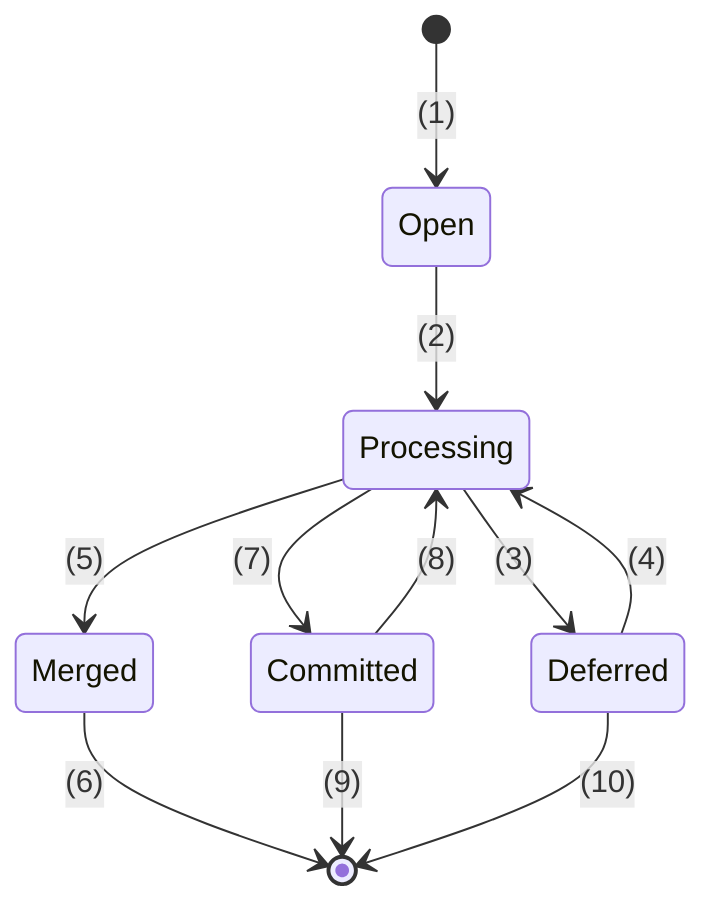

1. The first write while no batch is active (`Batch.ensure()`).
2. The microtask flush, or `flushSync()` / `tick()`.
3. Blocking async work is still pending.
4. That work resolved (`decrement()` queues a flush), or a stale reader was rescheduled into this batch.
5. Nothing blocking is left, but the batch depends on an earlier pending batch, so it merges into it.
6. Discarded when the batch it was merged into commits.
7. Nothing blocking is left and it doesn't depend on any earlier batch.
8. Non-blocking work (behind a `pending` snippet) resolves, so the batch processes and commits again.
9. Unlinked once `#pending` is 0.
10. Discarded (an error during traversal, or a fork is discarded).

While a batch is `Open`, `Deferred`, or `Committed` with work still in flight, it stays in the linked list and so affects what other batches see. Once it is unlinked, its values are simply part of the real world.

## 5. One batch, no async work

This is the path almost every update takes. When only one batch exists, `apply()` leaves `batch_values` as `null`, every `get()` returns `signal.v`, and `capture()` takes a fast path.

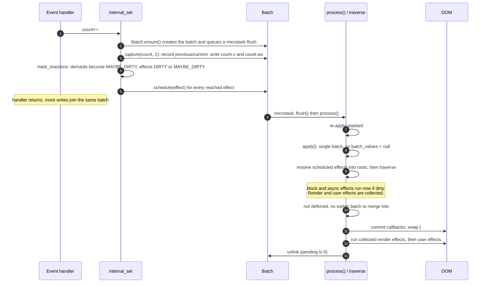

The decision logic inside `#process()`, which every scenario below goes through:

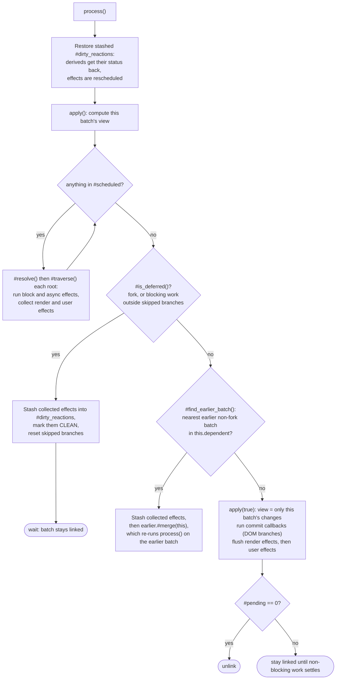

## 6. One batch with async work

```svelte
<p>{await fetch_thing(id)}</p>
```

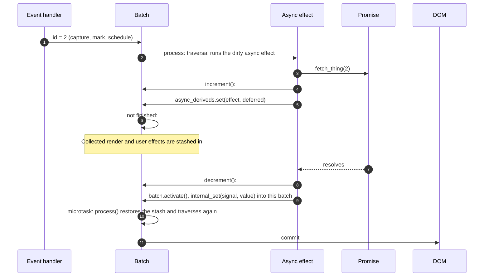

Details worth knowing:

- **Blocking vs non-blocking.** If the async effect is inside a `<svelte:boundary>` that is currently showing its `pending` snippet (`boundary.is_rendered()` is false), the work is _not_ blocking. The batch commits right away (the boundary keeps showing its pending snippet) but stays linked until `#pending` reaches 0, then processes and commits again. Effects inside that boundary that haven't run yet are deferred by the boundary itself (`Boundary.defer_effect`), not by the batch, and handed back to whichever batch is current when the boundary resolves.
- **Superseded runs.** If an async effect re-runs in the _same_ batch while an earlier run in that batch is still in flight, the earlier run's deferred is rejected with `OBSOLETE` and its result is ignored. While the boundary is still pending, a new run supersedes _all_ older in-flight runs of that expression, whichever batch they belong to. A run in a _different_ batch is not cancelled. Instead, the newer batch depends on the older one ([8](#8-how-batches-become-dependent-on-each-other), mechanism 4).
- **Where results go.** The handler calls `batch.activate()`, which follows `merged_into`, so a result always lands in whichever batch is still alive.

## 7. Several batches at once: time travelling

### 7.1 When does a write update the real value?

Every write goes through `Batch.capture()`, which always records the value in `batch.current` (and in the current `batch_values`). Only some writes update `signal.v` and `signal.wv`:

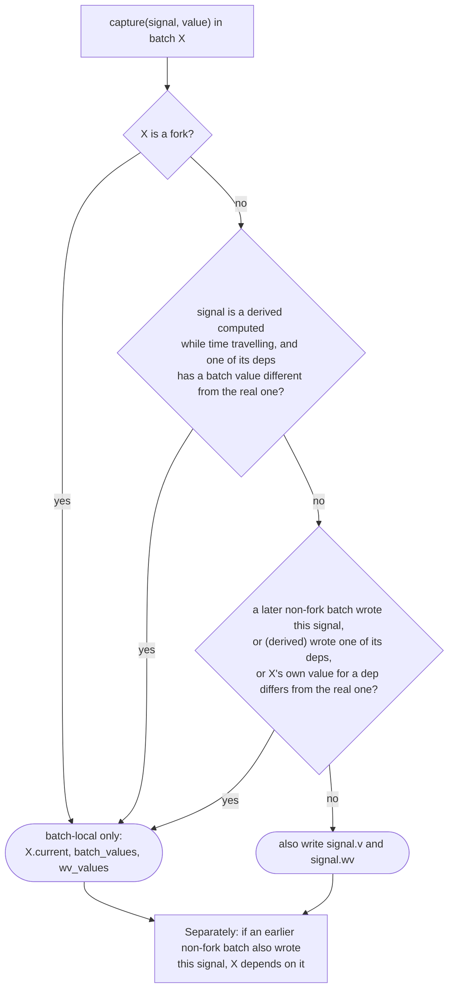

So the real world is roughly "the latest write to each signal, from any non-fork batch". A later batch's write wins over an earlier batch's write, even if the earlier batch commits afterwards. A derived is only written to the real world if it was computed from real inputs.

### 7.2 What a batch sees

`apply(include_earlier)` builds the view. Take three pending batches A < B < C, viewed from B:

| Signal was written by… | B's view during traversal: `apply()` | B's view at commit: `apply(true)` | An eager batch's view |
| ---------------------- | ------------------------------------ | --------------------------------- | --------------------- |
| B                      | B's value                            | B's value                         | n/a                   |
| A (earlier) only       | A's value (via the real value¹)      | **A's `previous`**: hidden        | `previous`: hidden    |
| C (later) only         | **C's `previous`**: hidden           | C's `previous`: hidden            | `previous`: hidden    |
| A and C                | A's value (from C's `previous`)      | A's `previous`                    | the oldest `previous` |
| nobody                 | real value                           | real value                        | real value            |

The same applies to write versions through `wv_values`.

¹ Earlier batches aren't put into `batch_values` during traversal. The batch just reads `signal.v`, which holds the earlier batch's value as long as that write reached the real world ([7.1](#71-when-does-a-write-update-the-real-value)).

- **During traversal**, a batch sees every earlier batch's changes as if they had already happened. That's what lets the later batch in the `a|b` example call `delay` with `a = 1`. Reading such a value makes this batch dependent on the earlier one (`held_sources`).
- **At commit**, a batch sees only its own changes on top of what is already committed. If it commits ahead of an earlier pending batch, the DOM must not show that batch's values. This is only safe because commit-time effects (render and user effects) never create dependencies. If something that runs during traversal had read the earlier batch's value, the two batches would already be connected and this batch couldn't commit first.
- **Later batches are always hidden.** A batch never sees the future. If it reads a signal a later batch wrote, that later batch is told about it (`stale_sources`, mechanism 3 in [section 8](#8-how-batches-become-dependent-on-each-other)).

### 7.3 Write versions and dirty checking

`is_dirty(reaction)` compares `wv_values.get(dep) ?? dep.wv` with `wv_values.get(reaction) ?? reaction.wv`. Hiding another batch's _value_ isn't enough on its own. Its _write version_ has to be hidden as well, otherwise reactions look dirty and re-run with an unchanged value ([10.8](#108-hidden-write-versions)).

There are two related rules:

- **Effects.** After an effect runs, `update_effect` checks whether any of its deps had a batch value that differs from the real value. If none did, `effect.wv` is updated as usual. If one did, the write version is stored only in `own_batch.stale_effects` (fed into `wv_values` by `apply()`), and every later batch gets the effect added to its `#dirty_reactions` as `MAYBE_DIRTY`, so they re-check it in their own view.
- **Deriveds.** While time travelling, a recomputed derived is only marked `CLEAN` if its value is the real value and was computed from real inputs. Otherwise it stays `MAYBE_DIRTY`, so other batches re-check it. `is_dirty` likewise doesn't reset a `MAYBE_DIRTY` _derived_ to `CLEAN` while time travelling. Effects can be reset, because block and async effects run right away and the rest are stashed. In practice, `DIRTY`/`CLEAN` act as a fast path for the single-batch case, and with multiple batches correctness comes from walking the graph and comparing versions.

### 7.4 Shared status flags: stashing dirtiness

Because statuses are shared, a batch that can't commit yet must not leave its effects `DIRTY`. If it did, the next batch to traverse would run them in _its_ view. So when a batch is deferred (or merged), `#defer_effects` / `defer_effect` (in `utils.js`):

1. records each collected effect's status (`DIRTY` beats `MAYBE_DIRTY`) in `#dirty_reactions`, and marks the effect `CLEAN`;
2. walks up the effect's derived dependencies and records any that aren't `CLEAN` as well. Another batch might evaluate them in the meantime and mark them `CLEAN` globally, and a `CLEAN` parent would make this batch skip checking them later.

At the start of the next `#process()`, deriveds get their recorded status back and effects are rescheduled. A plain effect is only reset to `MAYBE_DIRTY` if nobody has marked it `DIRTY` in the meantime.

`#skipped_branches` works the same way for branches. If a block switched branches in a batch that can't commit yet, the outgoing branch is skipped during traversal, and its dirty children are recorded (`reset_branch`) so they can be rescheduled if another batch keeps the branch alive.

## 8. How batches become dependent on each other

There are four ways for a dependency to arise. In every case the _later_ batch Y ends up depending on the _earlier_ batch X. What differs is which of the two did the reading or writing:

| #   | Mechanism                                                     | Where in the code                     | Direction                                                        |
| --- | ------------------------------------------------------------- | ------------------------------------- | ---------------------------------------------------------------- |
| 1   | Y **writes** a signal that earlier X also wrote               | `Batch.#capture`                      | Y depends on X                                                   |
| 2   | Y **reads** (during traversal) a signal earlier X wrote       | `get_batch_value` via `held_sources`  | Y depends on X                                                   |
| 3   | Earlier X **reads** a signal that later Y wrote               | `get_batch_value` via `stale_sources` | Y depends on X, **and** the reader is rescheduled to re-run in Y |
| 4   | Y re-runs an async effect whose earlier run in X is in flight | `async_derived`                       | Y depends on X                                                   |

Mechanism 3 is how "an earlier batch saw a value that a later batch has already changed" is fixed up. The earlier batch reads the later batch's `previous` value, which is right for its own view, and a microtask re-runs the reading reaction (or, for a derived, its dependents) inside the later batch, so the later batch also has a result computed from its own values. `stale_readers` makes sure a reaction that read several such values is only rescheduled once ([10.7](#107-an-earlier-batch-reads-a-value-a-later-batch-changed)).

What does **not** create a dependency:

- **Commit-time work.** Render effects and `$effect`s that run while a batch commits have `current_batch === null`, so their reads aren't tracked. This is why two batches that only share a template expression stay independent ([10.1](#101-independent-batches-the-later-one-commits-first)).
- **Forks.** Forks can appear in `held_sources`, but `#find_earlier_batch` ignores them, and `stale_sources` and the later-batch check in `capture` skip them.
- **Eager batches** never record dependencies and never merge ([10.10](#1010-stateeager-and-eager-batches)).

Dependencies are also **transitive through merges**. When Y merges into X, X takes over Y's dependencies, and any batch that depended on Y now depends on X ([10.6](#106-transitive-dependencies)).

## 9. Merging and committing

### 9.1 Merging

When a batch Y finishes its traversal with no blocking work left but depends on an earlier batch X, then `X.#merge(Y)` runs:

1. Y's `current` entries are copied into X. X keeps its own `previous` and takes Y's for signals it hadn't written.
2. **Y's in-flight async results are piped into X's in-flight runs of the same effects.** If X is still waiting on an older run of an expression that Y has already resolved, X's run resolves with Y's (newer) value. This is why an out-of-order resolution doesn't render the intermediate state ([10.3](#103-same-async-expression-later-batch-resolves-first)).
3. Dependencies are combined (see above). `#pending` and `#blocking_pending` are summed.
4. Commit and discard callbacks are re-registered on X. They still receive Y as their argument, so `BranchManager` can find Y's selections.
5. Skipped and unskipped branches are combined. Y's dirty reactions are transferred.
6. Y is unlinked, `Y.merged_into = X`, and Y is scheduled to be discarded when X commits.
7. X is processed straight away (`current_batch = X`, `X.#process()`). Usually X is still deferred and simply waits again.

### 9.2 Committing

Right before committing, `apply(true)` switches to the commit view ([7.2](#72-what-a-batch-sees)). Then:

1. **Commit callbacks** run, in registration order. For blocks, this is `BranchManager.#commit`, which moves the selected branch from its offscreen fragment into the DOM, and pauses/outros or destroys the branches that are no longer needed. Selections made by batches with a **lower id** are dropped (their offscreen branches are destroyed), and selections by later batches are kept. Batches that were merged into this one are discarded here too, through the callback `#merge` registered.
   - Dropping earlier selections is safe. If an earlier batch had changed this block's condition, this batch re-ran the block during traversal, read that condition, and so depends on the earlier batch (mechanism 2). It couldn't be committing first.
   - After a merge, the surviving batch's own re-evaluation of a block replaces any selection made by a batch merged into it (`BranchManager.ensure`), even though the merged batch had a higher id.
2. `previous_batch = this`. **Render effects** run, then **user effects**. A reaction that reads a signal _for the first time_ during this phase gets the real value rather than the batch view ([10.9](#109-first-time-reads-at-commit-see-the-real-value)).
3. The `settled()` promise resolves.
4. If `#pending` is 0, the batch is unlinked. Any batch created by writes in effects is processed straight away.

Branch appends are only deferred to commit for blocks that have already run once (`should_defer_append`). A block's first run renders straight into the DOM, because nothing is on screen yet that could be replaced too early.

## 10. Scenarios

In the diagrams, **A**, **B**, … are batches in creation order, and "screen" notes show what the DOM looks like at that point. Each scenario is a test you can run with `pnpm test runtime-runes -t <name>`.

### 10.1 Independent batches, the later one commits first

Test: `async-template-expression-entangle`

```svelte
<script>
	let a = $state(0);
	let b = $state(0);
	const c = $derived(a + b);
</script>

<p>{await delay(a)}</p><p>{c}</p>
```

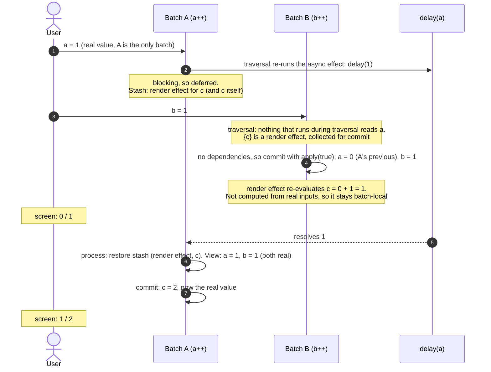

`a` and `b` were changed independently, so committing B first is equivalent to applying them in the order B, A. Neither intermediate screen is an impossible state.

### 10.2 Same async expression, resolving in order

Test: `async-linear-order-same-derived` (first half)

```svelte
<p>{a} + {b} = {await push(a, b)}</p>
```

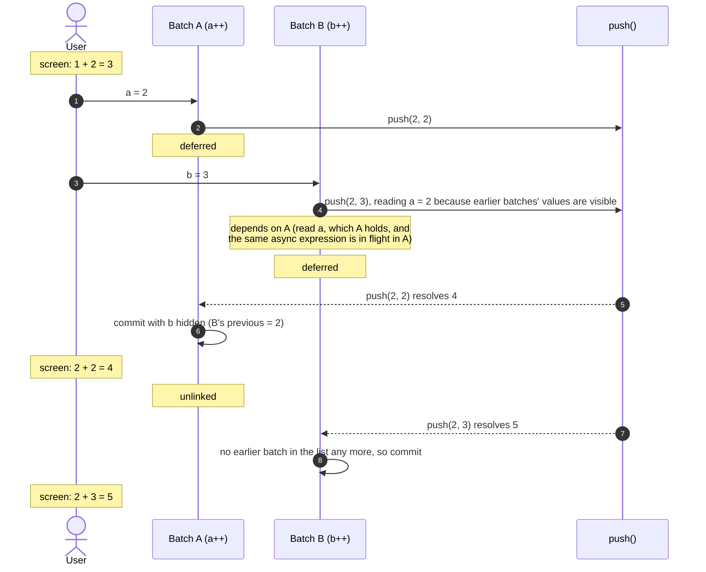

`push` was never called with `a = 1, b = 3`, a combination that never existed.

### 10.3 Same async expression, later batch resolves first

Test: `async-linear-order-same-derived` (second half)

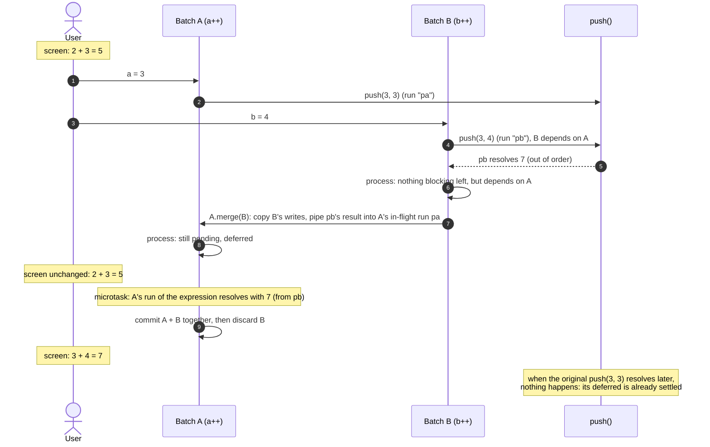

The intermediate state `3 + 3 = 6` is never shown. Later changes to an expression supersede earlier ones that haven't resolved yet, in the same way `{#await}` behaves for a single batch.

### 10.4 Batches connected through a block

Test: `async-state-block-overlap`

```svelte
{await push(a)}
{await push(b)}

{#if a < b}hello{:else}bye{/if}
```

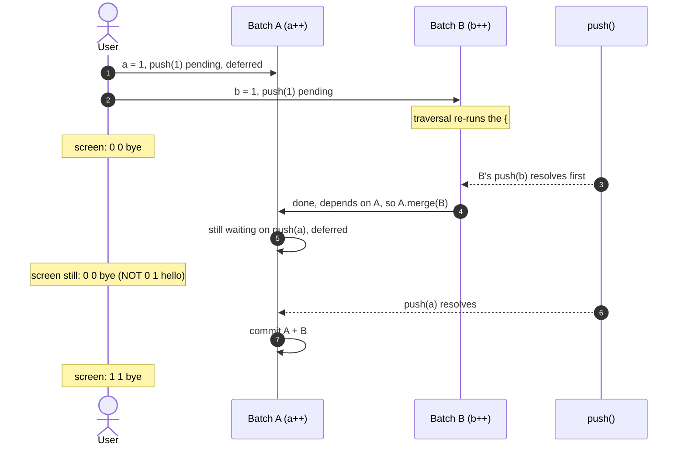

Committing B on its own would have shown `a = 0, b = 1`, so `hello`: a state that never existed in the timeline.

### 10.5 A new branch reads a value that a pending batch wrote

Test: `async-state-new-branch-4`

```svelte
{#if x?.x === 'universe'}
	{await delay(x.x)}
	<Child {x} />
{/if}

{#if y > 0}
	<Child {x} />
{/if}
```

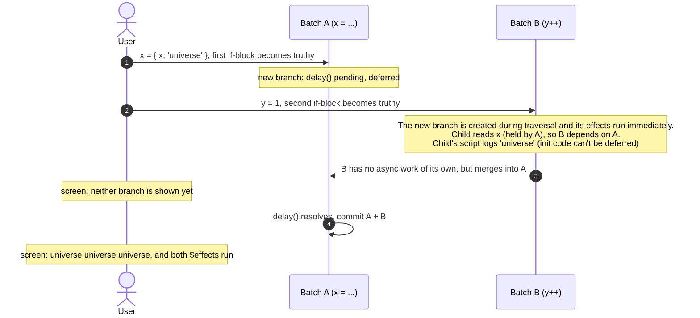

A batch with no async work at all can still be held back, if what it rendered depends on a batch that's pending.

### 10.6 Transitive dependencies

Test: `async-merge-transitive-dependency`

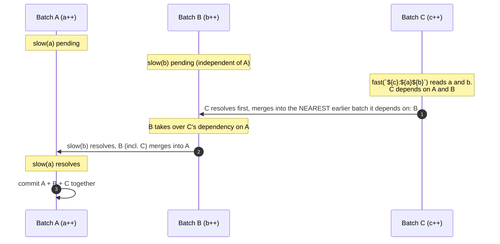

Without step 2, B (with C inside it) would have committed before A and shown A's uncommitted `a` through C's result.

### 10.7 An earlier batch reads a value a later batch changed

Test: `async-stale-read-multiple-no-double-run`

```svelte
<!-- Child.svelte -->
<script>
	let sa = $derived(await slow(a));
</script>

<p>{sa}</p><p>{await slow(b + c)}</p><p>{await track(sa, b, c)}</p>
```

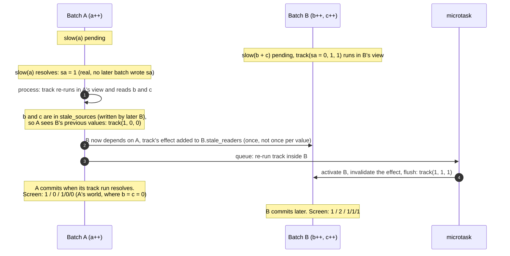

`track` is called four times in total: `0/0/0`, `0/1/1`, `1/0/0`, `1/1/1`. Each call, and each screen, corresponds to a state that exists in the timeline. (The test only asserts the calls and the final screen. The intermediate screen was confirmed by tracing.)

### 10.8 Hidden write versions

Test: `async-hidden-write-version-no-rerun`

```svelte
<!-- Child.svelte -->
<script>
	let sx = $derived(await slow(x));
	let d = $derived(sx > 0);
	$effect(() => log(`${s}/${d}`));
</script>
```

A: `x++` (pending). B: `s++` (pending, and B dirties the `$effect`). Then A resolves and commits. In A's commit view, `s` is hidden (it's 0, from B's `previous`), and **so is its write version**. `is_dirty($effect)` compares against the old `wv` of `s` and finds nothing changed, because `d` is still `true`, so the effect doesn't run. Without `wv_values`, the real `s.wv` would be newer than the effect's `wv`, and the effect would run and log `0/true` a second time. Once B commits, it logs `1/true`.

### 10.9 First-time reads at commit see the real value

Tests: `async-commit-stale-reader-changed`, `async-state-read-new-dependency`, `async-eager-read-new-dependency`

```svelte
<script>
	$effect(() => {
		if (y > 0) console.log(`effect ${x} ${y}`);
	});
</script>

<p>{await delay(x)}</p>
```

A: `x++`, pending. B: `y++`, which commits independently. In B's commit view `x` is 0. But the effect reads `x` **for the first time** (it's a new dependency), and in that case `get_batch_value` returns the real value, `1`. It logs `effect 1 1`. When A commits later, the effect doesn't run again, because A never saw the effect as a reader of `x`.

This is a deliberate exception to "the commit view only shows this batch's changes". Code that sits behind a condition that has only just become true often can't cope with older values (the typical case: `{#if user}{user.name}{/if}` where `user` was just set). The rule applies while a batch is committing or an eager batch is running, to any signal a reaction reads that isn't one of its dependencies yet, whether it's read synchronously or after an `await` (`see_latest` in `get_batch_value`).

### 10.10 `$state.eager` and eager batches

Test: `async-eager-block`

```svelte
{await delay(count)}

{#if $state.eager(count) !== count}
	<p>loading...</p>
{:else}
	<p>{count}</p>
{/if}
```

`$state.eager(expr)` evaluates `expr` against the **real** values (with `batch_values` and `stale_sources` switched off), and pushes changes through a separate **eager batch** instead of waiting for the pending batch:

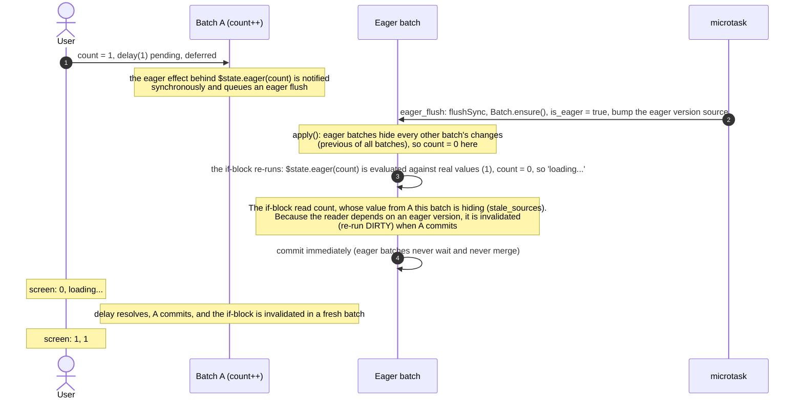

Rules for eager batches:

- they see the committed world, plus the real values inside `$state.eager(...)`;
- they don't record dependencies in either direction (`!current.is_eager` checks) and never merge;
- a reader that saw a stale value is only re-run if it also depends on an eager version (`dep.f & EAGER_EFFECT`), because only those can disagree with the committed world in a way that matters, e.g. `$state.eager(count) !== count`. It re-runs `DIRTY` when the batch owning the newer value commits.

### 10.11 Forks

Fork support in this branch is minimal and is reworked in pt-2.

- A fork batch is always deferred (`#is_deferred()` returns `true`) and never writes real values (`capture` treats every fork write as batch-local). While the fork is being set up, `update_derived` bumps `derived.wv` so that the discard path can invalidate it.
- Forks are ignored for dependencies: `#find_earlier_batch` skips them, and `stale_sources` and the later-batch check in `capture` don't include them.
- `fork.commit()` copies `batch.current` into the real values with fresh write versions, flushes eager effects, and then flushes the batch like a normal one.
- `fork.discard()` bumps the write version of every source the fork wrote, so that `MAYBE_DIRTY` deriveds recompute with real values, then discards the batch.
- **Not handled:** the real world overtaking a fork (a normal batch writing a source the fork also wrote, before the fork commits). `async-state-new-branch-fork-5`, which passes on `main`, is skipped on this branch for that reason.

## 11. Known rough edges

These came up while writing this document and are worth tidying up before merging:

- **`dependent` JSDoc is inverted.** It says "batches that depend on this batch", but every usage means "batches this batch depends on". Renaming it to something like `depends_on` would help.
- **`stale_effects` isn't maintained.** `update_effect` says the batch will "bring it up to date on commit", but nothing does this in pt-1 (that code lived in the fork commit path). The map is never cleared, and it isn't moved over in `#merge`. The likely effect is extra re-runs after a merge, not wrong output.
- **The stale-reader microtask doesn't check that the batch is still alive.** The microtask queued by mechanism 3 calls `batch.activate()` and `flush()` without checking whether the batch has since been committed or discarded.
- **Lazy getters are forced on hot paths.** `apply()` iterates `this.stale_effects`. `#find_earlier_batch`, `#merge` and `async_derived` call `.dependent` and `.async_deriveds` on every batch. Each of those calls allocates the collection that was meant to be created lazily.

## 12. Tracing the runtime

The sequences above were produced by adding a no-op hook such as `globalThis.__BT?.(message)` at these points, setting `globalThis.__BT = (m) => process.stderr.write(m + '\n')` in a test's `_config.js`, and also patching `HTMLElement.prototype.click` there so that clicks show up in the log:

- the `Batch` constructor (`new B<id>`) and `eager_flush` (`is eager`);
- the start of `#process()` (with `#pending` and `#dirty_reactions.size`);
- the `#is_deferred()` branch, the `earlier_batch` (merge) branch, and the commit / unlink points;
- `#capture`, noting whether the write went to the real world or stayed batch-local;
- the four places a dependency is recorded (`#capture`, both branches of `get_batch_value`, `async_derived`);
- the async result handler in `async_derived`, including `OBSOLETE` runs.

A run looks like this (`async-state-block-overlap`):

```
>>> click "a"
new B2
B2 capture source=1 REAL
B2 process (pending=0, dirty_reactions=0)
B2 deferred (blocking pending), stash 1+0 effects
>>> click "b"
new B3
B3 capture source=1 REAL
B3 process (pending=0, dirty_reactions=0)
  dep B3->B2 (read held)
B3 deferred (blocking pending), stash 1+0 effects
>>> click "pop"
async resolved in B3: 1
B3 process (pending=0, dirty_reactions=0)
B3 done, depends on B2 -> merge into it
B2 process (pending=1, dirty_reactions=1)
B2 deferred (blocking pending), stash 1+0 effects
>>> click "pop"
async resolved in B2: 1
B2 process (pending=0, dirty_reactions=1)
B2 COMMIT
B3 discard
B2 unlink
```
